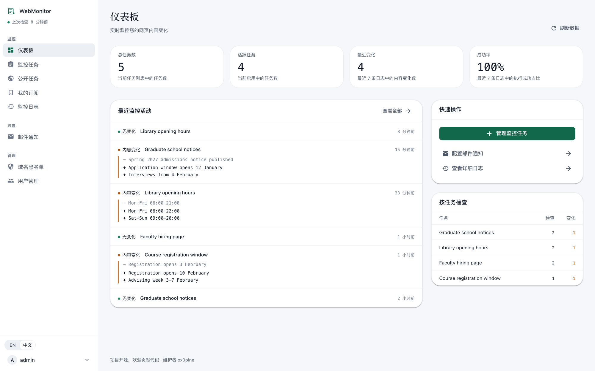

<h1 align="center">WebMonitor</h1>

<p align="center">
  <strong>Scheduled web checks. Email when the text changes.</strong>
</p>

<p align="center">
  Watch a price, an announcement, or a release note.<br>
  WebMonitor checks an XPath-selected page region and emails you when its text changes.
</p>

<p align="center">
  <a href="https://webmonitor.qfpqhyl.top/">Live demo</a> ·
  <a href="#install">Install</a> ·
  <a href="#create-your-first-monitor">First monitor</a> ·
  <a href="#email-notifications">Email</a> ·
  <a href="./README.zh-CN.md">简体中文</a>
</p>

<p align="center">
  
</p>

WebMonitor is a self-hosted service for monitoring one region of a web page. Enter a URL and XPath, choose a check interval, and review the results in the web app. JavaScript-rendered pages are supported. No AI service, model key, or GitHub account is required.

This repository is the original XPath-based WebMonitor and receives maintenance fixes. Active product development continues in [WebMonitor-Agent](https://github.com/webmonitor/WebMonitor-Agent), which creates monitors through conversation and supports conditions such as a target price or a newly added list item.

## Requirements

- Docker Engine with the Compose plugin (`docker compose version` should work).
- Port `8000` available on the host.
- The URL and XPath of the page region to monitor.
- For email, an SMTP server, port, sender account, password or app password, and recipient address.

## Install

The public GHCR image can be pulled anonymously; no registry login is needed.

### 1. Download the Compose file

```sh
mkdir webmonitor
cd webmonitor
curl -fsSLo compose.yaml https://raw.githubusercontent.com/webmonitor/WebMonitor/main/compose.yaml
```

The file uses `ghcr.io/webmonitor/webmonitor:latest` and creates one container named `webmonitor`.

### 2. Create `.env`

Create `.env` beside `compose.yaml` with this complete template:

```dotenv
# Public image; no registry login is needed.
# Pin a fixed release instead of latest if you prefer: ghcr.io/webmonitor/webmonitor:1.0.3
WEBMONITOR_IMAGE=ghcr.io/webmonitor/webmonitor:latest

# Required. A random signing key of at least 32 characters.
SECRET_KEY=CHANGE_ME_AT_LEAST_32_RANDOM_CHARACTERS

# The first administrator account. Used only when the database has no administrator.
ADMIN_USERNAME=admin
ADMIN_EMAIL=admin@example.com
ADMIN_PASSWORD=CHANGE_ME_STRONG_PASSWORD

# Optional.
DEBUG=false
LOG_LEVEL=INFO
SMTP_TIMEOUT_SECONDS=15
OUTBOX_MAX_ATTEMPTS=3
OUTBOX_RETRY_SECONDS=60
```

Replace the `SECRET_KEY` placeholder with a random string of at least 32 characters and set a strong `ADMIN_PASSWORD` before starting. Generate a key with either:

```sh
python -c "import secrets; print(secrets.token_hex(32))"
openssl rand -hex 32
```

| Setting | Purpose |
| --- | --- |
| `WEBMONITOR_IMAGE` | Optional image override. Pin a fixed tag such as `ghcr.io/webmonitor/webmonitor:1.0.3` for reproducible updates. |
| `SECRET_KEY` | Required signing key; at least 32 characters. |
| `ADMIN_USERNAME`, `ADMIN_EMAIL`, `ADMIN_PASSWORD` | Initial administrator credentials. The password must be 6–72 UTF-8 bytes. |
| `DEBUG`, `LOG_LEVEL` | Optional diagnostics. Leave them at `false` and `INFO` normally; debug SQL logs hide bind values, including SMTP passwords. |
| `SMTP_TIMEOUT_SECONDS` | Optional per-operation SMTP socket timeout; default `15`, maximum `300`. |
| `OUTBOX_MAX_ATTEMPTS` | Optional total delivery attempts per notification, including the first; default `3`. |
| `OUTBOX_RETRY_SECONDS` | Optional base retry delay; default `60`, multiplied by the attempt number. |
| `TARGET_ALLOWED_ORIGINS` | Optional comma-separated exact HTTP(S) origins for explicitly authorized internal targets. Empty by default; see [Target restrictions](#target-restrictions). |

The administrator values are used only when the database has no administrator. Changing them later does not change an existing login. SMTP accounts are configured per user in the app, not in `.env`.

### 3. Start and sign in

```sh
docker compose up -d --wait
```

Compose pulls the image anonymously and returns after the health check passes. Open **[http://localhost:8000/](http://localhost:8000/)** and sign in with the initial administrator credentials.

If startup fails, read the command output and `docker compose logs webmonitor`:

- A missing `SECRET_KEY` stops Compose before it creates a container.
- On a fresh database, an empty or invalid `ADMIN_PASSWORD` prevents startup.
- If port `8000` is occupied, stop the other program or change the left side of `"8000:8000"` in `compose.yaml`, then open the new port.

## Create your first monitor

1. Open **Monitor tasks** and click **Create task**.
2. Enter a recognizable **Task name**, the full **Monitor URL** (`http://` or `https://`), and the **XPath selector** of the element whose text should be compared.
3. Set **Check interval (seconds)** (default `300`, minimum `10`). Optionally select an **Email config**, add a **Task description**, or enable **Public task**.
4. Leave **Enable monitoring** off while testing the selector, then click **Create task**.
5. Click **Test monitor** on the new task row. **Test succeeded! Content:** previews the captured text; **Test failed** means the page did not load or the selector matched nothing.

A test loads the page once. It sends no email, writes no log entry, and does not change the saved result. If it fails or the preview is empty, copy a shorter, stable XPath in your browser and use **Edit task** to correct it; testing `//body` helps distinguish a loading problem from a selector problem. See [Troubleshooting](#troubleshooting) for other failures.

Once the preview is correct, enable monitoring in **Edit task** if necessary and click **Update task**. The first scheduled check runs about one interval after the task is saved or enabled. It is recorded as **Changed** because no baseline exists yet and sends one initial email when an email configuration is attached. Later checks are **Unchanged** unless the text changes or the check fails.

Open **Monitor logs**, select the task, and inspect **Checked at**, **Status**, **New content**, and **Error message**. The **Dashboard** summarizes totals, recent changes, and success rate.

### Target restrictions

Only text inside the selected element is compared; navigation, ads, and other page content are ignored. Every browser connection, including redirects and subresources, passes through a target-validating proxy. Local files, loopback, private, and reserved destinations are blocked by default. DNS results are checked before connecting to a fixed resolved address.

For an explicitly authorized internal target, set `TARGET_ALLOWED_ORIGINS` to exact origins such as `http://site:9000`, separated by commas. Scheme and port must match. Do not include paths or management origins.

## Email notifications

Each user configures their own SMTP account. A task can run without email and continue collecting and logging changes.

### Add and test SMTP

Open **Email configuration**, click **Add email config**, and enter:

| Field | What to enter |
| --- | --- |
| **Config name** | A label shown in task and subscription dropdowns |
| **SMTP server** | Your provider's host name, such as `smtp.gmail.com` |
| **SMTP port** | Usually `465` with SSL enabled, or `587` with SSL disabled |
| **Sender email** | The account that sends mail |
| **SMTP password** | The account password, app password, or authorization code required by the provider |
| **Receiver email** | The address that receives notifications |
| **Use SSL encryption** | On for port `465`; off for port `587`, which uses STARTTLS |

| Provider | Server | Port and encryption |
| --- | --- | --- |
| Gmail | `smtp.gmail.com` | `465` with SSL, or `587` with SSL off; use an app password |
| QQ Mail | `smtp.qq.com` | `465` with SSL; enable SMTP and use an authorization code |
| 163 Mail | `smtp.163.com` | `465` with SSL; enable SMTP and use a client authorization password |
| Outlook / Hotmail | `smtp.office365.com` | `587` with SSL off |

Save the configuration and click **Test connection**. WebMonitor sends exactly one test email to that configuration's **Receiver email**. **Test email sent successfully** means the SMTP server accepted it; check spam and the recipient address if it does not arrive. **Test email failed** indicates a rejected server, port, encryption setting, account, or password.

To notify the task owner, open **Edit task**, select the configuration under **Email config**, and click **Update task**. **No notifications** disables owner email without stopping checks.

Configurations belong to the account that created them. Subscribers to a public task choose their own configuration, so their notifications never use the task owner's mailbox.

### Delivery and retries

A successful scheduled check commits its baseline, check time, monitor log, and notification outbox in one database transaction. SMTP starts only after that commit. If the URL, XPath, configuration version, or active state changes while a page is being collected, the stale result is discarded without a log or notification.

Pending notifications are stored in the same SQLite database and recovered after a restart or interrupted send. Delivery is attempted up to `OUTBOX_MAX_ATTEMPTS` times, with delays based on `OUTBOX_RETRY_SECONDS`; every SMTP connection has a finite timeout and is closed after success or failure.

Delivery is **at least once**, not exactly once. If SMTP accepts a message but the process stops before recording delivery, recovery can send a duplicate. Permanently failed deliveries remain recorded as failed. Deleting a user also deletes that user's saved SMTP configurations and outbox records.

## Public tasks and subscriptions

Enable **Public task** to let other users on the instance find a running task on **Public tasks**. To subscribe:

1. Open **Public tasks** and click **Subscribe**.
2. Choose one of your own configurations in **Choose email configuration**.
3. Click **Confirm subscription**.

You need an email configuration before subscribing. Change notifications go to its **Receiver email**. Enabling or reactivating a subscription without an explicit configuration requires a default configuration; a disabled subscription may keep none.

**My subscriptions** lets you enable or disable notifications, change the email configuration, or cancel. A disabled subscription keeps its record but sends no email. Cancellation remains available after the owner pauses the task or makes it private; in that state, its name, URL, and owner are hidden and the row is marked unavailable. Notifications are delivered to all enabled subscribers in batches, including those beyond the first 100.

Each account may have 10 enabled subscriptions by default. Disabled subscriptions do not use a slot. **Public tasks** shows **Remaining slots**; an administrator can change the limit under **User management** → **Max subscriptions**.

## Pause, edit, and delete

- **Pause:** In **Edit task**, turn off **Enable monitoring** and click **Update task**. Scheduled checks stop, while the baseline and logs remain. Turn it back on to resume.
- **Edit:** Change the URL, XPath, interval, email configuration, description, or public setting in the same dialog, then use **Test monitor** to verify the selector.
- **Delete:** **Delete task** asks for confirmation and removes the task and its monitor logs.

## Troubleshooting

| Symptom | What to check |
| --- | --- |
| **Test failed** | Open the page in your browser, inspect the element, and try a shorter XPath. Test `//body` to check whether the page loads. |
| Empty **Content** preview | The element may have no text yet. Wait for asynchronous content or select the element that contains the text. |
| No log after creating a task | The first check runs after one interval. A **Paused** task never checks. |
| Status **Error** | Read **Error message** in **Monitor logs**. A timeout points to the page or network; a selector error points to the XPath. |
| **Test email failed** | Check the SMTP server, port, **Use SSL encryption**, sender account, and app password or authorization code. |
| **Changed** log but no email | Check for **No notifications**, disabled subscription notifications, the selected **Receiver email**, spam, and pending bounded retries. |
| **Subscribe** refused | Disable or cancel subscriptions in **My subscriptions**, or ask an administrator to raise **Max subscriptions**. |
| **Create task** refused | Use a full `http://` or `https://` URL and an allowed domain. An administrator can check **Blacklist management**; target restrictions may also block the destination. |

For container startup failures, begin with the Compose output and `docker compose logs webmonitor` as described in [Start and sign in](#3-start-and-sign-in).

## Data, backup, and updates

The supplied `compose.yaml` defines **no volume**. `/app/data/webmonitor.db` inside the container is the only store for accounts, tasks, email configurations, subscriptions, logs, and notification delivery records.

Recreating the container starts with an empty database. This can happen after an image tag change, `docker compose down`, `--force-recreate`, or an update of `latest`, because the service always pulls before starting. `docker compose restart` keeps the existing container and its data.

### Back up and restore

Stop the service and copy the database outside the container:

```sh
docker compose stop
docker cp webmonitor:/app/data/webmonitor.db ./webmonitor-backup.db
docker compose start
```

To restore:

```sh
docker compose stop
docker cp ./webmonitor-backup.db webmonitor:/app/data/webmonitor.db
docker compose start
```

A copied file is owned by root, while the app runs as `appuser`. If the app cannot write the restored database, fix ownership and restart:

```sh
docker compose exec -u root webmonitor chown appuser:appuser /app/data/webmonitor.db
docker compose restart
```

### Keep data across container recreation

To preserve data automatically, mount a named volume at `/app/data`. Create `docker-compose.override.yml` beside `compose.yaml`:

```yaml
services:
  webmonitor:
    volumes:
      - webmonitor-data:/app/data
volumes:
  webmonitor-data:
```

`docker compose up -d --wait` reads the override automatically. Back up before adding it to an instance that already has data: switching to a volume recreates the container.

### Update or roll back

Record the current image version and back up the database. Set `WEBMONITOR_IMAGE` in `.env` to the desired tag, then run:

```sh
docker compose pull
docker compose up -d --wait
```

The default database is inside the container, so recreation loses it unless storage is mounted separately. To roll back, restore the previous image tag and repeat the commands.

<details>
<summary>Build from source (development only)</summary>

A normal installation does not need the repository. To run code that is not in a released image:

```sh
git clone https://github.com/webmonitor/WebMonitor.git
cd WebMonitor
```

Create `.env` as described above, then build and start with the development override:

```sh
docker compose -f compose.yaml -f compose.build.yaml up --build -d --wait
```

This builds `deploy/Dockerfile` from the repository root, installs Chromium from Debian, and produces a large image. For local backend and frontend development, see [backend/README.md](./backend/README.md).

</details>

## License

[CC BY-NC 4.0](./LICENSE) — Share and adapt for non-commercial use, with attribution.

Created by 秋风飘起黄叶落.
